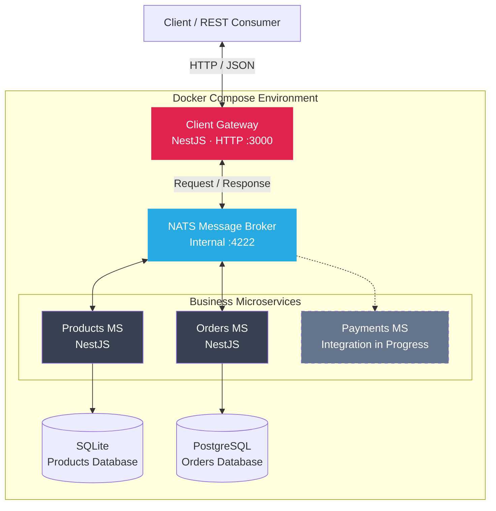

# 🛒 Products App — Distributed E-Commerce Microservices

<p align="center">
  
</p>

<h3 align="center">A Microservices-Based E-Commerce Backend</h3>

<p align="center">
  Arquitectura distribuida para la gestión de productos, órdenes y pagos, desarrollada con NestJS, NATS y Docker.
</p>

<p align="center">
  
  
  
  
</p>

<p align="center">
  
  
  
  
</p>

---

## 📖 Overview

**Products App** es un proyecto de backend basado en una arquitectura de microservicios, diseñado para explorar la construcción de sistemas distribuidos mediante servicios independientes y comunicación basada en mensajes.

La solución utiliza un **API Gateway** como punto de entrada HTTP, mientras que los microservicios intercambian mensajes mediante **NATS**, evitando exponer directamente sus interfaces internas a los consumidores.

Cada servicio mantiene su propia responsabilidad de negocio y puede evolucionar de manera independiente.

### Objetivos técnicos

- **Separación de responsabilidades:** cada microservicio implementa una capacidad específica del dominio.
- **Comunicación desacoplada:** utilización de NATS como intermediario de mensajes.
- **Persistencia independiente:** SQLite para productos y PostgreSQL para órdenes.
- **Contenerización:** entornos reproducibles mediante Docker y Docker Compose.
- **Repositorios independientes:** administración del código fuente mediante Git Submodules.
- **Extensibilidad:** incorporación progresiva de nuevos microservicios.

> **Nota:** Este proyecto es un entorno de aprendizaje y experimentación arquitectónica. No representa todavía una plataforma de comercio electrónico lista para producción.

---

## 🏗️ System Architecture

La aplicación utiliza un patrón de entrada única mediante API Gateway y comunicación interna con NATS.



### Request lifecycle

Un ejemplo simplificado del procesamiento de una solicitud:

1. El cliente realiza una petición HTTP al **Client Gateway**.
2. El Gateway valida los datos de entrada mediante DTOs y `ValidationPipe`.
3. El Gateway publica una solicitud mediante el cliente NATS.
4. El microservicio correspondiente procesa la operación.
5. El microservicio consulta o modifica su base de datos cuando corresponde.
6. La respuesta viaja nuevamente por NATS hasta el Gateway.
7. El Gateway entrega una respuesta HTTP al cliente.

Esta estructura mantiene separada la interfaz HTTP de la lógica interna de los microservicios.

---

## 🧩 Microservices

| Servicio | Responsabilidad | Persistencia | Estado |
|---|---|---|---|
| 🌐 **Client Gateway** | Entrada HTTP, validación y comunicación con servicios | — | Implementado |
| 📦 **Products MS** | Gestión y validación de productos | SQLite | Implementado |
| 🧾 **Orders MS** | Creación, consulta y actualización de órdenes | PostgreSQL | Configurado |
| 💳 **Payments MS** | Dominio de pagos y transacciones | Por definir | Integración en progreso |
| 📡 **NATS Server** | Transporte de mensajes entre servicios | — | Configurado |
| 🐘 **Orders DB** | Persistencia del dominio de órdenes | PostgreSQL 16.2 | Configurado |

### Service boundaries

**Client Gateway**

- Expone los endpoints REST.
- Valida los payloads entrantes.
- Transforma solicitudes HTTP en mensajes NATS.
- Centraliza el manejo de errores RPC.

**Products Microservice**

- Gestiona el catálogo de productos.
- Implementa operaciones CRUD.
- Permite validación de productos desde otros servicios.
- Utiliza SQLite para almacenamiento.

**Orders Microservice**

- Gestiona órdenes de compra.
- Administra los estados de las órdenes.
- Recibe productos y cantidades asociadas a una compra.
- Utiliza PostgreSQL para persistencia.

**Payments Microservice**

- Servicio contemplado para las operaciones del dominio de pagos.
- Declarado en la configuración de Docker Compose.
- Pendiente de completar y verificar su integración en el launcher.

---

## 🛠️ Technology Stack

| Categoría | Tecnología | Propósito |
|---|---|---|
| Backend Framework | NestJS | Aplicaciones backend modulares |
| Language | TypeScript | Desarrollo tipado |
| Message Broker | NATS | Comunicación entre microservicios |
| API | REST / HTTP | Interfaz pública del Gateway |
| Database | PostgreSQL | Persistencia de órdenes |
| Database | SQLite | Persistencia de productos |
| Containerization | Docker | Empaquetado de servicios |
| Orchestration | Docker Compose | Ejecución local de contenedores |
| Version Control | Git + Submodules | Gestión de repositorios independientes |

---

## 📂 Repository Structure

El repositorio principal, **products-launcher**, contiene la configuración de ejecución y las referencias a los repositorios individuales.

```text
products-launcher/
│
├── client-gateway/          # REST API Gateway
├── products-ms/             # Products domain
├── orders-ms/               # Orders domain
├── payments-ms/             # Payments integration*
│
├── .dockerignore            # Docker build exclusions
├── .gitignore               # Git ignored files
├── .gitmodules              # Submodule definitions
├── .env.example             # Environment template
├── docker-compose.yml       # Multi-container configuration
└── README.md                # Project documentation
```

`*` La carpeta `payments-ms` requiere que su referencia Git esté correctamente registrada en el repositorio principal y que el desarrollador tenga acceso al repositorio de origen.

### Repository strategy

Cada microservicio mantiene su código fuente en un repositorio independiente.

El launcher funciona como un **repositorio de composición**, permitiendo controlar qué versión de cada servicio forma parte del entorno.

Esto permite realizar cambios, commits y actualizaciones de forma independiente entre los diferentes servicios.

---

## 🚀 Getting Started

### Prerequisites

Para ejecutar la aplicación necesitás:

- [Git](https://git-scm.com/downloads)
- [Docker](https://www.docker.com/products/docker-desktop/)
- [Docker Compose](https://docs.docker.com/compose/)
- Acceso a los repositorios Git de los microservicios

Node.js y npm serán necesarios si también deseas ejecutar los microservicios directamente fuera de Docker.

### 1. Clone the repository

Cloná el repositorio principal incluyendo todos los submódulos registrados:

```bash
git clone --recurse-submodules \
  https://github.com/Nest-Microservices-Kometha/products-launcher.git

cd products-launcher
```

Si ya clonaste el repositorio sin sus submódulos:

```bash
git submodule update --init --recursive
```

Verificá las referencias actuales:

```bash
git submodule status
```

> Si algún repositorio utiliza SSH o es privado, necesitás tener configurados los permisos correspondientes en GitHub.

### 2. Configure environment variables

Generá el archivo de configuración local:

```bash
cp .env.example .env
```

Configuración de referencia para desarrollo:

```dotenv
# API Gateway
CLIENT_GATEWAY_PORT=3000

# Internal Microservices
PRODUCTS_MS_PORT=3001
ORDERS_MS_PORT=3002
PAYMENTS_MS_PORT=3003

# NATS Message Broker
NATS_URL=nats://nats-server:4222
```

**Importante:** `PAYMENTS_MS_PORT` debe añadirse al archivo `.env.example`, ya que está utilizado en Docker Compose pero todavía no forma parte de la plantilla publicada.

Los puertos de los microservicios son valores internos de configuración. No implican automáticamente que estén expuestos por HTTP.

### 3. Build and run

Construí e iniciá los contenedores:

```bash
docker compose up --build
```

Para ejecutar en segundo plano:

```bash
docker compose up -d --build
```

### 4. Verify containers

Comprobá el estado de los servicios:

```bash
docker compose ps
```

Para inspeccionar los registros:

```bash
docker compose logs -f
```

Para ver únicamente el Gateway:

```bash
docker compose logs -f client-gateway
```

### 5. Test the API

Una vez que los servicios estén iniciados, ejecutá:

```bash
curl -i http://localhost:3000/api/products
```

Si la conexión y los servicios funcionan correctamente, el Gateway responderá con el resultado de la operación del catálogo.

---

## 🌐 Network & Ports

| Servicio | Puerto | Alcance |
|---|---|---|
| Client Gateway | 3000 | HTTP, publicado al host |
| Products MS | 3001* | Configuración interna |
| Orders MS | 3002* | Configuración interna |
| Payments MS | 3003* | Configuración propuesta |
| NATS Client | 4222 | Comunicación dentro de Docker |
| NATS Monitoring | 8222 | Puerto publicado; requiere habilitar monitoring |
| PostgreSQL | 5432 | Publicado al host para desarrollo |

`*` Valores sugeridos de configuración. La comunicación entre los microservicios NestJS utiliza NATS, no necesariamente conexiones HTTP a estos puertos.

### NATS Monitoring

Para habilitar explícitamente el endpoint de monitoreo, agregá a `nats-server` en Docker Compose:

```yaml
nats-server:
  image: nats:latest
  command: ["-m", "8222"]
  ports:
    - "8222:8222"
```

Luego podrás consultar:

- `http://localhost:8222/varz` — información del servidor.
- `http://localhost:8222/connz` — conexiones NATS.
- `http://localhost:8222/routez` — información de rutas.

> El puerto de monitoreo no debe exponerse públicamente sin controles de red adecuados.

---

## 📡 API Reference

**Base URL**

```text
http://localhost:3000/api
```

Todas las solicitudes HTTP deben realizarse a través del Client Gateway.

### 📦 Products API

| Method | Endpoint | Description |
|---|---|---|
| GET | `/products` | Listar productos |
| GET | `/products/:id` | Consultar un producto |
| POST | `/products` | Crear un producto |
| PATCH | `/products/:id` | Actualizar un producto |
| DELETE | `/products/:id` | Eliminar un producto |

#### Create a product

**Request**

```http
POST /api/products
Content-Type: application/json
```

```json
{
  "name": "Mechanical Keyboard",
  "price": 89.99
}
```

**cURL**

```bash
curl -X POST http://localhost:3000/api/products \
  -H "Content-Type: application/json" \
  -d '{
    "name": "Mechanical Keyboard",
    "price": 89.99
  }'
```

#### Get products

```bash
curl http://localhost:3000/api/products
```

#### Update a product

```bash
curl -X PATCH http://localhost:3000/api/products/1 \
  -H "Content-Type: application/json" \
  -d '{"price": 79.99}'
```

### 🧾 Orders API

| Method | Endpoint | Description |
|---|---|---|
| GET | `/orders` | Listar órdenes |
| GET | `/orders/:status` | Filtrar órdenes por estado |
| GET | `/orders/id/:id` | Consultar una orden por identificador |
| POST | `/orders` | Crear una orden |
| PATCH | `/orders/:id` | Modificar el estado de una orden |

#### Create an order

**Request**

```http
POST /api/orders
Content-Type: application/json
```

```json
{
  "items": [
    {
      "productId": 1,
      "quantity": 2,
      "price": 89.99
    }
  ]
}
```

**cURL**

```bash
curl -X POST http://localhost:3000/api/orders \
  -H "Content-Type: application/json" \
  -d '{
    "items": [
      {
        "productId": 1,
        "quantity": 2,
        "price": 89.99
      }
    ]
  }'
```

#### Get orders

```bash
curl http://localhost:3000/api/orders
```

Las respuestas HTTP y sus códigos dependerán de la implementación y de las validaciones de cada servicio.

---

## 🔄 Inter-Service Communication

Los microservicios utilizan el transporte NATS de NestJS mediante `ClientProxy` y handlers decorados con `@MessagePattern()`.

### Example: Products communication

Desde el Gateway:

```typescript
return this.client.send(
  { cmd: 'find_all_products' },
  paginationOptions,
);
```

En Products MS:

```typescript
@MessagePattern({ cmd: 'find_all_products' })
findAll(@Payload() paginationDto: PaginationDto) {
  return this.productsService.findAll(paginationDto);
}
```

El Gateway no ejecuta directamente los métodos de negocio del servicio. Envía un mensaje al broker para que el microservicio correspondiente lo procese.

### Messaging patterns

| Pattern | Implementation |
|---|---|
| Request / Response | `ClientProxy.send()` |
| Message Handlers | `@MessagePattern()` |
| Message Transport | NATS |
| Error Handling | RPC exceptions and Gateway filters |

La arquitectura permite introducir posteriormente comunicación basada en eventos con `ClientProxy.emit()` y `@EventPattern()`, cuando un proceso requiera un modelo de publicación/suscripción.

---

## 🐳 Docker Operations

Comandos de operación habituales:

| Command | Description |
|---|---|
| `docker compose up -d --build` | Construir e iniciar |
| `docker compose up -d` | Iniciar en background |
| `docker compose ps` | Consultar contenedores |
| `docker compose logs -f` | Consultar logs |
| `docker compose logs -f orders-ms` | Logs de órdenes |
| `docker compose restart orders-ms` | Reiniciar Orders MS |
| `docker compose down` | Detener y eliminar contenedores |
| `docker compose build --no-cache` | Reconstruir imágenes sin caché |
| `docker compose config` | Validar configuración Compose |

Para ejecutar un servicio específico:

```bash
docker compose up -d --build products-ms
```

Para detener el entorno:

```bash
docker compose down
```

**Precaución:** evitá eliminar volúmenes o datos persistentes sin verificar primero su contenido.

---

## 🔗 Git Submodules Management

Los servicios están administrados mediante Git Submodules.

Esto permite que el launcher apunte a commits específicos de los repositorios de cada microservicio.

### List configured submodules

```bash
git submodule status
```

### Initialize all submodules

```bash
git submodule update --init --recursive
```

### Update one submodule

```bash
git submodule update --remote products-ms
```

Registrá el nuevo commit del submódulo en el launcher:

```bash
git add products-ms
git commit -m "chore: update products-ms submodule"
git push origin main
```

### Add a new microservice

Ejemplo de incorporación de un futuro servicio:

```bash
git submodule add \
  git@github.com:Nest-Microservices-Kometha/shipping-ms.git \
  shipping-ms
```

Después:

```bash
git add .gitmodules shipping-ms
git commit -m "chore: add shipping microservice"
git push origin main
```

También será necesario agregar el servicio al archivo `docker-compose.yml` y configurar sus variables de entorno.

> **Payments MS:** ya tiene una entrada en `.gitmodules` y una definición en Docker Compose. Antes de registrarlo nuevamente, verificá si el commit del launcher ya contiene su referencia Git mediante `git ls-tree HEAD payments-ms`.

---

## 🧪 Development Workflow

Para mantener una separación clara entre los componentes:

1. Implementar los cambios dentro del repositorio del microservicio correspondiente.
2. Ejecutar sus pruebas y validaciones.
3. Realizar commit y push dentro de ese repositorio.
4. Actualizar la referencia del submódulo en `products-launcher`.
5. Construir los contenedores afectados.
6. Verificar la comunicación de extremo a extremo a través del Gateway.

### Example workflow

```bash
# Update service reference
git submodule update --remote orders-ms

# Track new submodule commit
git add orders-ms
git commit -m "chore: update orders service"

# Rebuild affected container
docker compose up -d --build orders-ms
```

Este flujo permite evolucionar un microservicio sin incluir todo su código fuente directamente en el historial del launcher.

---

## 🔐 Security Considerations

La configuración actual está orientada principalmente al desarrollo local.

Antes de desplegar en un entorno productivo, se recomienda:

- Externalizar las credenciales de PostgreSQL y eliminar contraseñas del archivo Compose.
- Utilizar secretos administrados para información sensible.
- Restringir la exposición de PostgreSQL y del monitoreo NATS.
- Configurar autenticación, autorización y rate limiting en el Gateway.
- Incorporar health checks y límites de recursos.
- Fijar versiones de imágenes Docker y evitar depender de etiquetas `latest`.
- Aplicar escaneo de dependencias y de contenedores.
- Proteger las comunicaciones entre servicios cuando se desplieguen en redes no confiables.

**La configuración de desarrollo no debe reutilizarse directamente en producción.**

---

## 🩺 Troubleshooting

### Submodules appear empty

Ejecutá:

```bash
git submodule update --init --recursive
```

Si el problema persiste, verificá las referencias:

```bash
git submodule status
```

### GitHub returns Permission denied (publickey)

Comprobá la autenticación SSH:

```bash
ssh -T git@github.com
```

Si la autenticación funciona, verificá que el repositorio exista y que tengas permisos para acceder.

### Containers cannot connect to NATS

Comprobá que la variable de conexión utilice el nombre del servicio Docker:

```dotenv
NATS_URL=nats://nats-server:4222
```

No utilices `localhost` dentro de otro contenedor para referirte al servidor NATS.

### Environment variable is missing

Verificá las variables necesarias:

```bash
docker compose config
```

Comprobá también que `.env` contenga todos los valores que consume `docker-compose.yml`.

### A microservice does not start

Inspeccioná los registros:

```bash
docker compose logs -f products-ms
```

Verificá las variables de entorno, la configuración de la base de datos y la conectividad con NATS.

### API returns 404

Asegurate de incluir el prefijo global:

```text
/api
```

Por ejemplo:

```text
http://localhost:3000/api/products
```

No todas las rutas están disponibles directamente desde `/`.

---

## 🗺️ Roadmap

Este proyecto continuará evolucionando progresivamente.

### Core Services

- [x] API Gateway.
- [x] Products Microservice.
- [x] Orders Microservice.
- [x] NATS integration.
- [x] Docker Compose environment.
- [x] Git Submodules architecture.
- [ ] Finalizar integración de Payments Microservice.
- [ ] Implementar flujo completo de órdenes y pagos.

### Architecture & Reliability

- [ ] Autenticación con JWT.
- [ ] Rate limiting.
- [ ] Health checks.
- [ ] Correlation IDs para trazabilidad.
- [ ] Reintentos controlados y manejo de timeouts.
- [ ] Idempotencia de operaciones de pago.
- [ ] Observabilidad y distributed tracing.
- [ ] Pruebas de integración y end-to-end.

### DevOps & Deployment

- [ ] Pipeline CI/CD con GitHub Actions.
- [ ] Validación automatizada de imágenes Docker.
- [ ] Gestión segura de secretos.
- [ ] Configuración diferenciada de DEV, QA y PRD.
- [ ] Despliegue en Kubernetes.

> Los elementos pendientes representan objetivos de evolución y no funcionalidades ya disponibles.

---

## 🤝 Contributing

Las contribuciones, sugerencias y mejoras son bienvenidas.

1. Realizá un fork del repositorio correspondiente.
2. Creá una rama descriptiva:

```bash
git checkout -b feature/my-feature
```

3. Implementá y verificá los cambios.
4. Creá un commit siguiendo una convención clara:

```bash
git commit -m "feat: add new feature"
```

5. Publicá tu rama:

```bash
git push origin feature/my-feature
```

6. Abrí un Pull Request documentando los cambios.

Para modificaciones en un microservicio, enviá el Pull Request al repositorio del servicio. Actualizá después la referencia del submódulo en el launcher cuando corresponda.

---

## 📚 References

Documentación oficial utilizada como referencia conceptual:

- [NestJS Documentation](https://docs.nestjs.com/)
- [NestJS Microservices](https://docs.nestjs.com/microservices/basics)
- [NestJS NATS Transport](https://docs.nestjs.com/microservices/nats)
- [NATS Documentation](https://docs.nats.io/)
- [Docker Compose Documentation](https://docs.docker.com/compose/)
- [Git Submodules](https://git-scm.com/book/en/v2/Git-Tools-Submodules)
- [PostgreSQL Documentation](https://www.postgresql.org/docs/)

---

## 📄 License

El README original declara la licencia MIT. Para formalizarla, incorporá un archivo `LICENSE` al repositorio con el texto correspondiente.

---

<p align="center">
  Built with NestJS, NATS & Docker.
</p>

<p align="center">
  <strong>Designed & Developed by Kometha</strong>
</p>

<p align="center">
  <a href="https://github.com/Nest-Microservices-Kometha">GitHub Organization</a>
</p>
